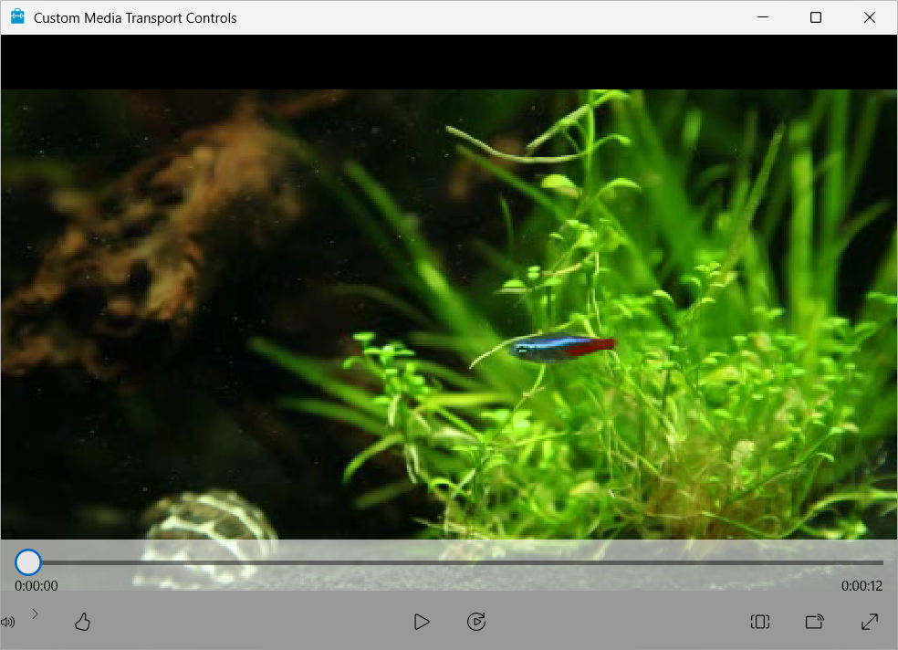

# Custom Media Transport Controls

This WinUI 3 sample demonstrates how to derive from `MediaTransportControls`, provide a custom control template, add a new transport command, and retain the standard media playback experience.

## Features

- Hosts packaged media in a `MediaPlayerElement`.
- Derives a custom control from `MediaTransportControls`.
- Adds an accessible **Like video** command to the transport bar.
- Raises and handles a custom event from the control template.
- Preserves play, pause, seek, playback-rate, aspect-ratio, casting, and full-screen commands.
- Uses a high-contrast-aware custom progress color and keyboard-focusable controls.
- Supports the Visual Studio **Package** and **Unpackaged** launch profiles.

## Build and run

1. Install the prerequisites described in [System requirements for Windows app development](https://learn.microsoft.com/windows/apps/windows-app-sdk/system-requirements).
2. Open `cs-winui\CustomMediaTransportControls.sln` in Visual Studio 2022.
3. Select `x86`, `x64`, or `ARM64` and either the `Debug` or `Release` configuration.
4. Choose the **Custom Media Transport Controls (Package)** profile for the packaged app, or **Custom Media Transport Controls (Unpackaged)** for the unpackaged app.
5. Build and run the solution.

After launch, use the transport bar to play the bundled video. Select **Like video** to exercise the custom command, or open the playback-rate menu to change the playback speed.

## Asset provenance

The sample code and bundled `Assets/fishes.wmv` media were obtained from the Microsoft [Windows-universal-samples](https://github.com/microsoft/Windows-universal-samples) repository at commit [`4eb2fcb499c5bc549e918920cfd2b64396a650d9`](https://github.com/microsoft/Windows-universal-samples/commit/4eb2fcb499c5bc549e918920cfd2b64396a650d9). The media originated at:

- `SharedContent/media/Samples/fishes.wmv`

That repository distributes the content under the [MIT License](https://github.com/microsoft/Windows-universal-samples/blob/4eb2fcb499c5bc549e918920cfd2b64396a650d9/LICENSE). Packaging artwork (`SplashScreen.png`, `Square150x150Logo.png`, `Square44x44Logo.png`, `Wide310x150Logo.png`, and `logo.png`) is customized from this repository's WinUI C# sample template. The window icon (`windows-sdk.ico`) comes directly from that template. All are covered by this repository's MIT license.

## Related links

- [MediaTransportControls class](https://learn.microsoft.com/windows/windows-app-sdk/api/winrt/microsoft.ui.xaml.controls.mediatransportcontrols)
- [MediaPlayerElement class](https://learn.microsoft.com/windows/windows-app-sdk/api/winrt/microsoft.ui.xaml.controls.mediaplayerelement)
- [Custom controls overview](https://learn.microsoft.com/windows/apps/design/controls/custom-controls-overview)
- [Windows App SDK documentation](https://learn.microsoft.com/windows/apps/windows-app-sdk/)
